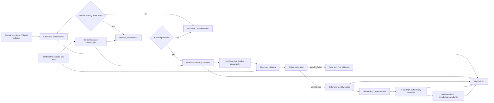

# INKSIGHTS Sales Operating System — Implementation Contract v1 (DRAFT)
_23 October 2026 · INKSIGHTS only · Engineering authority: this GitHub repository_
_Status: reviewable feature branch; NOT deployed, NOT a replacement CRM_

## Outcome
A UK tattoo-studio prospect must move through discovery, qualification, permission,
engagement, purchase, onboarding, report delivery, justified expansion and measurement
without an uncontrolled duplicate record, unverified revenue claim or unlawful outreach.

## Verified October 23 baseline
- Supabase INKSIGHTS project eu-west-2: 110 existing `public` tables, 349
  `studio_candidates`, 19 `visibility_studios`, 9 `studios`, 228
  `website_events`, 23 `integration_events`, 1 operational `orders` row.
- Operational `orders` row is `phase1-test-deposit`, 100 pence, not an audit.
- HubSpot: 18 companies / 11 contacts / 2 deals; existing default pipeline is
  **INKSIGHTS Sales Pipeline**. No bulk stage migration authorised.
- Stripe live: active £395 GBP price `price_1UG09NCX6YhLOssgi93xsGnH` and active
  link `plink_1UG09jCX6YhLOssgBDzdEF5X`. Nine returned live Checkout Sessions
  expired and unpaid; zero verified paid £395 audits in that returned set.
- Existing: `public-contact-intake`, `hubspot-sync-v1`,
  `stripe-checkout-webhook-v1`, `integration_events`, `report_versions`,
  `website_events`, tool-submission storage, rate limiting and RLS.
- These counts are snapshots, not weekly metrics and not a comparable funnel.

## Canonical ownership
| Object / question | Authority | Durable link |
|---|---|---|
| Legal/studio discovery and provider evidence | Supabase | `studio_candidates`, `studio_source_observations` |
| Verified studio identity | Supabase | **`visibility_studios.id`** |
| Operational studio audit data | Supabase | `studios.id` sharing the same UUID where a row exists |
| CRM company, buyer, deal, stage and owner | HubSpot | Native HubSpot IDs; never replace with an INKSIGHTS shadow CRM |
| Customer payment/subscription truth | Stripe | Webhook-confirmed event + provider-retrieved session |
| Payment evidence and delivery/order bridge | Supabase | `orders` plus proposed `sales_order_links` |
| Intake, score, diagnosis and report version | Supabase | `public_tool_submissions`, `audits`, `report_versions` |
| Website attribution | Supabase | `website_events`; consent-scoped and deduplicated |
| Leadership reporting | Derived read-only aggregates | Split direct / assisted / unattributed |

**Do not** create a third studio-master table. Candidate identity is provisional;
one verified studio UUID can have multiple external ID links. Domain/name/email
alone must not merge studios. Shared chains, multi-site groups and UK trading names
require manual conflict resolution. Create `studios` operational row only when
intelligence/delivery functionality needs it.

## Data flow

## Lifecycle vs existing HubSpot deals
The ten user-facing lifecycle terms are **not** a proposal to overwrite CRM stages.
Use a derived operational state that references the HubSpot deal stage and verified
commercial/delivery events. An unidentified studio remains research data, not a
phantom HubSpot deal.

| Operational milestone | Minimum evidence | Existing HubSpot stage |
|---|---|---|
| Identified | Deduplicated candidate observation | No deal required |
| Qualified | ICP and evidence reviewed | Qualified, only if a deal exists |
| Contact permitted | Channel-specific assessment, documented permissions, no suppression | Metadata gate, not a new stage |
| Engaged | Meaningful reply, tool submission or inbound qualification | New Lead / Qualified as appropriate |
| Discovery | Completed need, authority and fit discussion | Qualified |
| Offer presented | Approved product, price and offer date | Audit Proposed |
| Won | Signed webhook + verified provider status + qualifying order | Paid / Booked |
| Onboarding | Paid order linked to studio + intake started | In Delivery |
| Delivered | QA, customer access and deliverables accepted | Completed |
| Expansion opportunity | Evidence justifies next service | **New associated deal**, don't reopen audit |

Existing HubSpot stages in order: New Lead (6160204007), Qualified
(6161797357), Audit Proposed (6160204008), Payment Pending (6161522918),
Paid / Booked (6161522919), In Delivery (6160204009), Completed
(6161512647), Closed Lost (5869532403).
HubSpot stage probability is a forecast feature, NOT a payment source.
The moment a payment event is verified, the server updates the correct CRM deal
through an idempotent, retryable integration. Never update a deal based on
browser success-page navigation.

## Direct vs assisted acquisition paths
- **Direct:** studio purchases from the website without prior verified qualified
  seller contact, where self-service checkout attribution is present.
- **Assisted:** a qualified sales conversation predates the verified purchase;
  associate the relevant CRM deal, not any company-wide conversation.
- **Unknown:** conflicting or insufficient evidence; never default to direct.
- Store first touch, latest meaningful touch, UTM source/medium/campaign,
  referral page, event timestamps, consent state and campaign evidence.
  Website sessions may be anonymous; do not join by fingerprint alone.
- Count a Stripe Checkout Session only once using its provider session ID.
- Distinguish `£0` approved waiver from £395 gross list value and actual
  amount collected. Never count a waived pilot as paid revenue.

## Conversion and delivery controls
1. Public form validates required fields, checks versioned acknowledgement,
   rate limits and persists the normalized submission before revealing scores.
2. Resolve canonical studio only on verified strong identifiers. If ambiguous,
   create a review item. Never auto-merge multiple branches or trading entities.
3. Idempotent CRM resolver: look up verified link; if absent search HubSpot company
   by high-confidence keys, review conflicts, upsert company and contact, associate
   a deal only for a real sales opportunity.
4. Persist contact permission as a separate, channel-scoped record. Form data
   processing acknowledgement does not imply promotional-email consent.
5. Stripe: verify raw webhook signature; check account/mode; retrieve session
   and line items on server; check the approved price/link and `payment_status`.
   Use an **atomic** paid-state write so replayed out-of-order events cannot
   reverse `paid` to `pending`. Treat paid order creation and CRM sync as
   independent, retryable jobs.
6. Map the paid order to one studio via trusted metadata or reviewed identity;
   unresolved identity MUST NOT authorize access to another studio's data.
7. Report delivery requires intake, report QA, authorized user access and
   recorded customer acceptance; link report version and cost evidence.
8. Expansion requires a verified finding, proposed intervention, expected ROI,
   and explicit customer interest; no automatic recurring subscription.

## Payment/code audit findings (requires patch before deployment)
- The **currently deployed** `stripe-checkout-webhook-v1` uses an upsert on
  `orders.stripe_session_id` that can set a previously paid session back to
  pending after a delayed/duplicate unpaid event. This feature branch has NOT
  solved that race; implement an atomic state-monotone RPC before fulfilment.
- This branch now requires `session.payment_status === "paid"` even on an
  asynchronous success event; previously event type alone was accepted. It
  also records 0 as collected cash for pending sessions.
- This branch also protects the *currently disabled* TanStack Stripe webhook
  by retrieving the Checkout Session server-side and requiring it to be paid
  and complete; neither webhook patch is deployed.
- Existing paid order has no reliable `studio_id` linkage; raw email/domain
  matches are not authorization.
- A Companies House number identifies a legal entity, not a physical location.
  The resolver requires a Google Place ID or a company/domain key combined
  with postcode, and flags inconsistent identifiers for human review.
- Existing webhook skips non-live events intentionally; sandbox verification
  must use an isolated test handler and separate credentials.
- Generated route-tree CI issue was previously reported in PR #137; treat any
  inherited failure separately from tests for this feature.

## UK outreach gate
For business electronic marketing, PECR distinguishes corporate subscribers
from sole traders and many partnerships. Corporate email may not require PECR
consent, but transparency, opt-outs and UK GDPR lawful basis can still apply.
For sole traders and unknown entity types, demand consent or a documented
applicable soft opt-in. Social direct messages are also electronic mail.
Always suppress objections and opt-outs, retain evidence of assessment and
include sender identity/opt-out. A human approves claims and first messages.
Source: https://ico.org.uk/for-organisations/direct-marketing-and-privacy-and-electronic-communications/business-to-business-marketing/

## Weekly scorecard — one stable metric dictionary
Week is Monday 00:00 to Sunday 23:59 Europe/London.
Freeze event taxonomy, dedupe rules and source freshness before publishing.

| Metric | Numerator and denominator | Authority |
|---|---|---|
| Qualified studios added | DISTINCT studio IDs first qualified during week | reviewed research events |
| Accounts approached | DISTINCT studios with compliant sent outreach during week | HubSpot email/activity + event log |
| Positive qualified engagement rate | DISTINCT positive qualified responses / DISTINCT approached | HubSpot qualification events |
| Discovery calls completed | DISTINCT completed qualifying meetings | CRM meeting records |
| Purchases / qualified conversations | DISTINCT verified paid audit sessions / DISTINCT qualified conversations | Stripe + HubSpot, cohort-aligned |
| Verified audit revenue | SUM actual GBP pence collected for paid, unrefunded audit sessions | Stripe, independently reconciled |
| Acquisition cost per paying studio | Attributable acquisition cash spend / DISTINCT paying studios | marketing spend + Stripe |
| Delivery hours and contribution | recorded delivery time; collected revenue minus directly attributable delivery costs | time entries + Stripe |
| Audit → implementation | DISTINCT audit customers buying follow-on work / eligible delivered-audit cohort | CRM + verified payments |
| Monitoring attachment | eligible delivered studios with active paid monitoring / eligible delivered studios | Stripe subscriptions |
| Retention | cohort retained after defined measurement window / cohort starting count | Stripe subscription period snapshots |

For each rate: define the cohort, hold numerator/denominator periods consistent,
and show NULL/“Not yet measurable” rather than zero when denominator or evidence
is missing. Do not mistake website `page_view` for a lead or lead response.
Do not claim CAC until acquisition spend and paying studio identity reconcile.
Direct and assisted paths must be shown as separate cuts, with Unknown visible.

## Daily and weekly operating procedure
- **Daily (read-only discovery):** ingest Companies House/places observations;
  dedupe; update provenance and next verification dates; triage identity conflicts.
- **Daily (review gate):** score ICP, review lawful outreach route, prepare
  source-backed observations, human-approve personalised messages.
- **Event-driven:** accept website forms, persist before score display; sync CRM
  idempotently; verify Stripe server-side; open onboarding only after verified
  payment and identity; queue downstream failures for retry.
- **Weekly (Monday, UK):** reconcile HubSpot deal records, source events,
  Stripe completed payments, identity-linked delivery records and spend.
  Publish ten KPI series with direct/assisted segmentation and exceptions.
- **Monthly:** compare actual outcomes to intervention baseline; propose next
  constraint or monitoring only where supported by evidence.

## Release checklist / gates
**Now in feature branch:** pure decision contracts, node:test suite, draft schema,
and this contract. No production mutation.

1. Validate branch and migration-history compatibility; run `node --test
   tests/sales-ops.test.mjs`; no secrets required.
2. Convert proposed SQL via `supabase migration new` (the Supabase CLI is not
   available in this working environment), apply to isolated staging only.
3. Run schema integrity, Supabase advisors, RLS negative tests, identity conflict
   tests, test-mode signed Stripe webhook fixtures, no-paid-downgrade race tests.
4. Build server-only identity and permission services and durable retry/dead
   letter handling; bind them to website submission and CRM sync.
5. Build atomic Stripe order transition + provider session/price re-verification.
6. Build role-protected Studio Sales Overview powered by derived facts, not
   browser writes. Test full direct and assisted journeys.
7. Verify £395 checkout → Stripe event → unique order → correct HubSpot company,
   contact, deal → authorised intake → report → follow-up opportunity.
8. Perform consent/suppression and data-retention review; block mass send.
9. Check preview CI, then obtain **explicit production approval** for migrations,
   runtime changes and merging to main, per repository `AGENTS.md`.
10. Run live monitoring after release: orphan orders, CRM lag, duplicates,
    failed webhooks, unpaid-to-paid transitions and delivery SLA exceptions.

## Source and risk classification
VERIFIED = live records or repository code read on October 23.
PROPOSED = SQL and lifecycle in this branch, not deployed.
BLOCKED = controlled schema/production changes pending explicit approval.
RISK = sources incomplete; first conversion performance still unproven.

No bulk CRM writes, direct marketing sends, real payments, schema mutations,
deployments or privilege changes were performed by this work.
